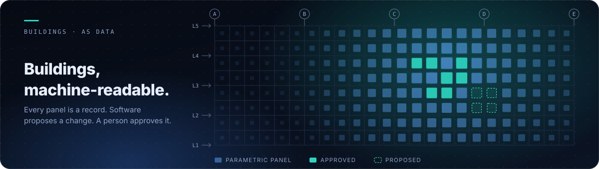
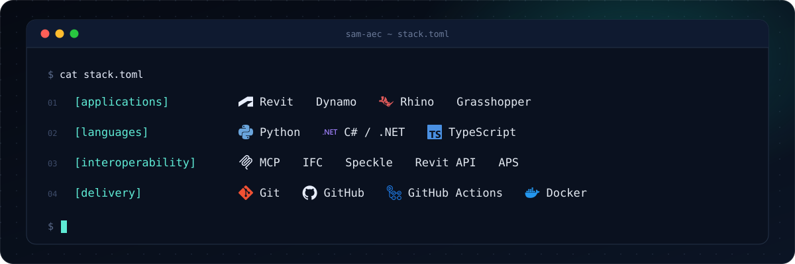

<div align="center">



# A. Sam Mohammad

**I make buildings machine-readable.**

A building model is a database you can stand in. After 15+ years in construction and façade engineering, I write the software that lets programs query it, and that keeps them from editing it without a signature.

Netherlands · [**AEC Model Bridge**](https://github.com/Sam-AEC/aec-model-bridge) · [**FacadeIQ (beta)**](https://facadedata.vercel.app/) · [**LinkedIn**](https://www.linkedin.com/in/a-sam-mohammad-92790416b)

</div>

## Flagship: [AEC Model Bridge](https://github.com/Sam-AEC/aec-model-bridge)

**The Revit MCP server that asks first.**

AI assistants such as Claude and Codex read the Revit model you have open. By default, nothing in it changes until a person approves a plan. It is open source: a Python MCP server and a C# Revit add-in.

```text
TOOLS     307, counted from the running server
REVIT     2024 to 2027, one add-in build per year
GATE      AI proposes -> you approve -> Revit changes
PROOF     every executed plan leaves a proof file; a revert goes through the same gate
TESTS     about 3,700 automated; CI does not start Revit
STATUS    1.5.0, pre-release: reads checked in live Revit 2024, writes not yet
```

[Quick start](https://github.com/Sam-AEC/aec-model-bridge#quick-start) (mock mode, no Revit needed) · [Tool catalogue](https://github.com/Sam-AEC/aec-model-bridge/blob/main/docs/tools-generated.md) · [Security](https://github.com/Sam-AEC/aec-model-bridge/blob/main/docs/security.md) · [Releases](https://github.com/Sam-AEC/aec-model-bridge/releases/latest)

## Also: [FacadeIQ](https://facadedata.vercel.app/) (beta)

A free web app that runs several early-stage façade calculations and environmental checks, so an engineer or architect gets a first technical overview before detailed engineering starts.

## Stack



## Contact

I take on selected work in Revit tooling, façade systems and AEC products. [Message me on LinkedIn](https://www.linkedin.com/in/a-sam-mohammad-92790416b) with one line on the workflow you want to fix.
